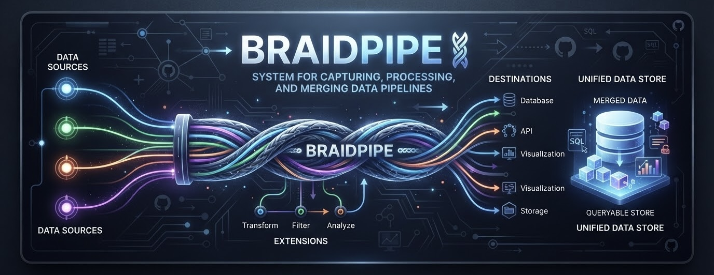

# Braidpipe



> Many streams. One Flow. Weave async data pipelines in YAML.

## What is Braidpipe?

Braidpipe is an async data orchestrator that fits in a single YAML file.

Each playbook runs as one isolated process — we call it a **Braid**. No workers, no DAG servers, no infrastructure to 
manage. Define your sources, transformations, and destinations. Run it. Done.

## Install

```bash
pip install git+https://github.com/braidpipe/braidpipe.git@v0.1.0
```

*PyPI package coming as soon as their verification gremlins clear.*

## Quick Start

```bash
# Scaffold your first braid
braidpipe init hello

# Run it
braidpipe run ~/braids/hello/playbook.yml
```

## What makes it different?

- **Declarative YAML.** The playbook *is* the application. No embedded scripts, no hidden logic.
- **One playbook, one process.** Each braid is isolated. If one stalls, the others keep running.
- **Lightweight state.** Checkpoints and telemetry live in local SQLite and JSON — no Redis or database server required.
- **Context with auto-spill.** Scalars stay in memory. Collections and large payloads transparently offload to SQLite so your memory stays flat.

## Example Playbook

```yaml
version: "1"
name: hello_braid

source:
  connector: generator
  config:
    count: 100
    prefix: "customer"

destination:
  connector: stdout
```

## Architecture

Braidpipe separates **choreography** from **execution**:

- **Connectors** bring data in (sources) and send it out (destinations).
- **Statements** transform data in-flight.
- The engine handles async streaming, checkpoints, and event logging.

So far we ship three connectors: `generator`, `stdin`, and `stdout`.

## What's Next?

**v0.2.0** will add the `http` connector and Polars-powered filter statements — merge and transform data from multiple APIs in one YAML file.

## License

MIT